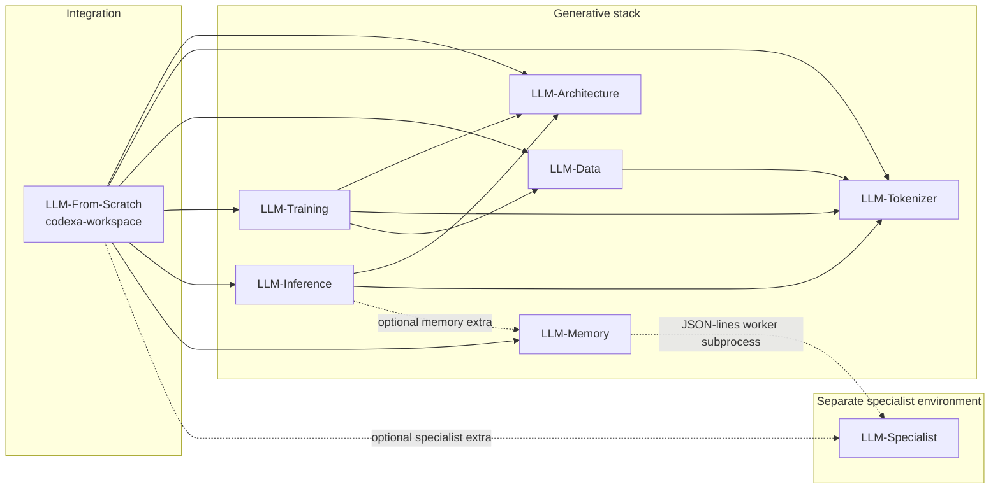

# Codexa

Codexa is a from-scratch, decoder-only Transformer language-model project built
in PyTorch. Every stage — corpus preparation, a byte-level BPE tokenizer, the
model, training, checkpoints, inference and optional conversational memory — is
implemented in the project's own code and trained on a single 16 GB RTX 4080.

Codexa is actively developed research and engineering work. It is **not** a
released model or a chat assistant: no checkpoint has been accepted or promoted,
and the recorded evaluations below describe an undertrained 934M-parameter base.

> **About this repository.** This is the public Codexa showcase: the central
> directory for the project. It links the eight component repositories as Git
> submodules under [`components/`](components/), documents how they fit
> together, and retains the original single-repository PyTorch source for
> reference. Day-to-day development happens in a separate development workspace
> that checks out the same eight repositories side by side; changes land in the
> component repositories first and are then pinned here intentionally.

## Modular architecture

Codexa is split into independently versioned Python packages. Each component
repository owns one responsibility, keeps its own Git history and test suite,
and declares its dependencies on the others explicitly in `pyproject.toml`.
`LLM-From-Scratch` is the integration repository: it owns orchestration,
evaluation, recipes, central tests and the training records, and pins a tested
version set of the other seven in its `compatibility.json`.

| Component | Repository | Responsibility | Submodule |
| --- | --- | --- | --- |
| **LLM-From-Scratch** | [LLM-From-Scratch-PyTorch-Codexa-v1](https://github.com/golba98/LLM-From-Scratch-PyTorch-Codexa-v1) | Integration workspace: orchestration, evaluation, recipes, central tests, model card and training records | [`components/LLM-From-Scratch`](components/LLM-From-Scratch) |
| **LLM-Architecture** | [LLM-Architecture-PyTorch-Codexa-v1](https://github.com/golba98/LLM-Architecture-PyTorch-Codexa-v1) | Decoder-only Transformer, RMSNorm, SwiGLU, learned/RoPE positions, KV caches and native checkpoint readers | [`components/LLM-Architecture`](components/LLM-Architecture) |
| **LLM-Tokenizer** | [LLM-Tokenizer-PyTorch-Codexa-v1](https://github.com/golba98/LLM-Tokenizer-PyTorch-Codexa-v1) | Byte-level BPE and shared conversation serialization | [`components/LLM-Tokenizer`](components/LLM-Tokenizer) |
| **LLM-Data** | [LLM-Data-PyTorch-Codexa-v1](https://github.com/golba98/LLM-Data-PyTorch-Codexa-v1) | Corpus provenance, cleaning, splits, mixtures, binary token packing and memmap datasets | [`components/LLM-Data`](components/LLM-Data) |
| **LLM-Training** | [LLM-Training-PyTorch-Codexa-v1](https://github.com/golba98/LLM-Training-PyTorch-Codexa-v1) | Base and conversational training loops, optimizers, recoverable checkpoints and monitoring | [`components/LLM-Training`](components/LLM-Training) |
| **LLM-Inference** | [LLM-Inference-PyTorch-Codexa-v1](https://github.com/golba98/LLM-Inference-PyTorch-Codexa-v1) | Native completion and chat, context composition and exports | [`components/LLM-Inference`](components/LLM-Inference) |
| **LLM-Memory** | [LLM-Memory-PyTorch-Codexa-v1](https://github.com/golba98/LLM-Memory-PyTorch-Codexa-v1) | Scoped SQLite conversation storage and exact cosine retrieval | [`components/LLM-Memory`](components/LLM-Memory) |
| **LLM-Specialist** | [LLM-Specialist-PyTorch-Codexa-v1](https://github.com/golba98/LLM-Specialist-PyTorch-Codexa-v1) | Frozen EmbeddingGemma encoder adapter and independently trained classifiers | [`components/LLM-Specialist`](components/LLM-Specialist) |

The [component catalog](documentation/COMPONENTS.md) gives each component's
purpose, dependencies, entry points, documentation and pinned commit.

### How the components depend on each other

Solid arrows are declared Python package dependencies; dashed arrows are
optional or out-of-process relationships.



Architecture and Tokenizer are leaves. Memory does not import Specialist; it
talks to a separately launched Specialist worker over JSON lines. Specialist
runs in its own environment so that its Transformers/tokenizers pins never mix
with the generative environment. No component imports the integration
repository.

## Verified capabilities

Everything listed here is implemented in the pinned component sources and
covered by their tests or recorded validation.

- **Model** — pre-normalized decoder-only Transformer with RMSNorm, causal
  scaled-dot-product attention, SwiGLU feed-forward layers, learned or RoPE
  positions, tied token/output embeddings and KV-cache decoding.
- **Tokenizer** — byte-level BPE trained from scratch with stable reserved IDs
  0–7 (`<pad>`, `<bos>`, `<eos>`, `<unk>` and the `system`/`user`/`assistant`/`end`
  conversation markers).
- **Data** — Unicode normalization, exact deduplication, deterministic
  hash-based train/validation splits, source mixtures, and binary token arrays
  read through memory-mapped windows.
- **Provenance** — each pipeline stage writes a JSON manifest with SHA-256
  checksums of inputs, outputs and settings.
- **Training** — BF16 autocast with FP32 weights, gradient checkpointing,
  8-bit AdamW, gradient accumulation, and resumable checkpoints that restore
  model, optimizer, scheduler, RNG and data-cursor state.
- **Inference** — native completion and chat with stopping rules and bridge
  protocol. GPT-2/Llama export adapters exist but are **experimental** and do
  not preserve every Codexa architecture faithfully.
- **Conversational memory (opt-in)** — scoped SQLite storage and exact cosine
  retrieval over 768-dimensional embeddings from a frozen EmbeddingGemma
  encoder, with encoder-failure fallback. Off by default.

## Training architecture and methodology

The active base configuration is
[`configs/models/1b.yaml`](configs/models/1b.yaml):

| Layers | Hidden | Heads | SwiGLU width | Context | Vocabulary | Parameters |
| ---: | ---: | ---: | ---: | ---: | ---: | ---: |
| 24 | 1,536 | 24 | 6,144 | 2,048 | 16,384 | 934,356,480 |

- Random initialization; no pretrained weights or pretrained tokenizer.
- Micro-batch 1 with gradient accumulation 32, full 2,048-token windows.
- Peak learning rate 2e-4, 2,000 warmup steps over a 10,000-step schedule,
  weight decay 0.1, gradient clipping 1.0, seed 42.
- Base pretraining sources: FineWeb-Edu and English Wikipedia. UltraChat and
  OASST1 are kept separately for supervised conversational stages.
- Stages are gated: a conversational stage is blocked until the base model
  passes fixed coherence, repetition, termination and held-out-loss gates.

## Recorded results

These numbers come from the training records in `LLM-From-Scratch`. They are
reported with their original caveats, and none of them amounts to a promoted
model.

| Measurement | Value | Caveat | Source |
| --- | --- | --- | --- |
| Packed base corpus | 12.82B tokens (61.10% FineWeb-Edu, 38.90% Wikipedia), 13.38M documents | Exact deduplication only; near-duplicate clustering incomplete | [Capability diagnosis][diagnosis] |
| Base training exposure | 655.36M target tokens ≈ 0.70 tokens/parameter (5.11% of the corpus) | Undertraining is plausible | [Capability diagnosis][diagnosis] |
| Final historical validation perplexity | 28.477 | Four FineWeb windows (8,192 target tokens); not a capability measure | [Capability diagnosis][diagnosis] |
| Stage-2 conversational pilot (200 steps) | Validation loss 2.652 → 2.379; held-out test loss 2.271 | Lower loss did not improve conversation; **not promoted** | [Stage 2 results][stage2] |
| Five-checkpoint qualification (240 development cases) | 0.0% on strict instruction, factual exact-format and arithmetic checks for every candidate | No initializer selected; human review pending | [Qualification][qualification] |
| GPU checkpoint qualification | Peak 9.057 GiB allocated / 11.859 GiB reserved; bitwise-exact restore | GPU restore-time gate failed; `production_ready=false` | [Qualification][qualification] |
| Consolidation test suites | Integration: 121 passed, 5 skipped; component suites passed | Recorded on the development machine | [Validation][validation] |

No standard public benchmark results (for example MMLU or HellaSwag) are
recorded for Codexa, and none are claimed.

## Getting started

### Clone with all components

```bash
git clone --recurse-submodules https://github.com/golba98/LLM-Codexa-v1-PyTorch.git
cd LLM-Codexa-v1-PyTorch
```

For an existing clone, run `git submodule update --init`. Submodules are pinned
to exact commits; see [working with submodules](documentation/SUBMODULES.md).

### Work on the components

`components/` reproduces the sibling layout the integration repository expects
(`LLM-From-Scratch` next to the other seven). The component packages are not
published to PyPI; install them from source in dependency order and keep the
specialist environment separate. The integration repository documents its
[environments][environments] and [sibling layout][sibling-layout]; with an
environment provisioned:

```bash
cd components/LLM-From-Scratch
python run.py test -q
python run.py --repo LLM-Architecture test -q
python run.py train --help
python run.py generate --help
```

Each component README lists its own command-line entry points (for example
`python -m llm_tokenizer.cli.train_tokenizer --help`).

### Retained single-repository source

This repository also keeps the original single-repository implementation,
developed with Python 3.14:

```bash
python -m venv .venv
.venv/bin/pip install -r requirements/dev.txt
.venv/bin/python -m pytest
```

Install the PyTorch build that matches your CUDA version first if the default
wheel does not. Model weights, datasets and tokenizers are never distributed in
any Codexa repository.

| Folder | Contents |
| --- | --- |
| `components/` | The eight component repositories as Git submodules |
| `src/` | Retained model, data, training, inference, memory and specialist code |
| `scripts/` | Commands grouped by purpose; see the [command guide](scripts/README.md) |
| `configs/` | Model, run, data, evaluation, testing and specialist settings |
| `tests/` | Regression tests and small fixtures |
| `schemas/` | Dataset and run-report schemas |
| `requirements/` | Development and specialist dependencies; base dependencies are in `requirements.txt` |
| `documentation/` | Showcase guides and historical rebuild records |
| `data/`, `checkpoints/`, `logs/`, `exports/` | Local generated artifacts, excluded from Git |

## Roadmap

Open work recorded in the project's planning and training records:

- [ ] Complete the pending human reviews: 156 curated dataset proposals and
  blinded model comparisons.
- [ ] Choose the next training path — continued foundational pretraining,
  corrective supervised fine-tuning, or both — from that evidence.
- [ ] Pass the full GPU checkpoint qualification, including the restore-time
  gate, and secure sufficient disk and VRAM headroom.
- [ ] Run scalable near-duplicate clustering, or record exact-only deduplication
  as an approved limitation.
- [ ] Run the 8,192-versus-16,384 tokenizer bake-off and record the production
  selection.
- [ ] Fill and freeze a production run manifest before any long training run.
- [ ] Establish an independent off-disk backup of training assets.

## Documentation

- [Component catalog](documentation/COMPONENTS.md) — every repository, its role
  and its pinned commit.
- [Working with submodules](documentation/SUBMODULES.md) — cloning, pinning and
  updating components.
- Integration repository: [README][fs-readme], [model card][model-card],
  [architecture][architecture], [phase plan][phase-plan],
  [validation][validation].
- Training records: [session decisions][decisions], [capability
  diagnosis][diagnosis], [qualification][qualification], [Stage 2
  results][stage2].
- Historical rebuild records retained in this repository:
  [architecture](documentation/reference/ARCHITECTURE.md),
  [model card](documentation/reference/MODEL_CARD.md),
  [phase plan](documentation/planning/PHASE_PLAN.md),
  [dataset](documentation/reference/DATASET.md),
  [tokenizer](documentation/reference/TOKENIZER.md),
  [conversational memory](documentation/reference/CONVERSATIONAL_MEMORY.md),
  [specialist](documentation/reference/SPECIALIST.md),
  [workflow commands](documentation/commands/WORKFLOWS.md) and the
  [earlier retirement notice](documentation/reference/RETIREMENT_PENDING.md).
  These predate the 16,384-entry vocabulary and still quote the earlier
  921,773,568-parameter, 8,192-vocabulary configuration.

## License and contributing

Source code in this repository and in all eight component repositories is
released under the [MIT License](LICENSE). Model-weight licensing is
undetermined until a release review accounts for upstream dataset terms;
FineWeb-Edu requires ODC-By attribution.

Contributions belong in the component repository that owns the change: open
issues and pull requests there. Pull requests to this showcase update its
documentation or deliberately move a submodule pin. Please do not commit model
weights, datasets, tokenizers or private logs to any Codexa repository.

[fs-readme]: https://github.com/golba98/LLM-From-Scratch-PyTorch-Codexa-v1/blob/b980ea7b477ae3f7f3c76a0a755dac80e1af3652/README.md
[model-card]: https://github.com/golba98/LLM-From-Scratch-PyTorch-Codexa-v1/blob/b980ea7b477ae3f7f3c76a0a755dac80e1af3652/MODEL_CARD.md
[architecture]: https://github.com/golba98/LLM-From-Scratch-PyTorch-Codexa-v1/blob/b980ea7b477ae3f7f3c76a0a755dac80e1af3652/documentation/reference/ARCHITECTURE.md
[phase-plan]: https://github.com/golba98/LLM-From-Scratch-PyTorch-Codexa-v1/blob/b980ea7b477ae3f7f3c76a0a755dac80e1af3652/documentation/planning/PHASE_PLAN.md
[validation]: https://github.com/golba98/LLM-From-Scratch-PyTorch-Codexa-v1/blob/b980ea7b477ae3f7f3c76a0a755dac80e1af3652/VALIDATION.md
[environments]: https://github.com/golba98/LLM-From-Scratch-PyTorch-Codexa-v1/blob/b980ea7b477ae3f7f3c76a0a755dac80e1af3652/documentation/migration/ENVIRONMENTS.md
[sibling-layout]: https://github.com/golba98/LLM-From-Scratch-PyTorch-Codexa-v1/blob/b980ea7b477ae3f7f3c76a0a755dac80e1af3652/documentation/migration/SIBLING_LAYOUT.md
[decisions]: https://github.com/golba98/LLM-From-Scratch-PyTorch-Codexa-v1/blob/b980ea7b477ae3f7f3c76a0a755dac80e1af3652/documentation/training/SESSION_DECISIONS.md
[diagnosis]: https://github.com/golba98/LLM-From-Scratch-PyTorch-Codexa-v1/blob/b980ea7b477ae3f7f3c76a0a755dac80e1af3652/documentation/training/CODEXA_934M_FOUNDATIONAL_CAPABILITY_DIAGNOSIS.md
[qualification]: https://github.com/golba98/LLM-From-Scratch-PyTorch-Codexa-v1/blob/b980ea7b477ae3f7f3c76a0a755dac80e1af3652/documentation/training/CODEXA_934M_FINAL_QUALIFICATION_MODEL_SELECTION.md
[stage2]: https://github.com/golba98/LLM-From-Scratch-PyTorch-Codexa-v1/blob/b980ea7b477ae3f7f3c76a0a755dac80e1af3652/documentation/training/STAGE2_RESULTS.md
